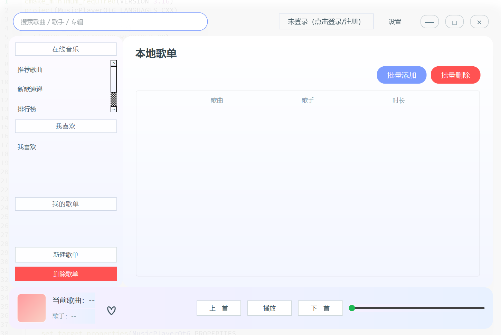

## 简易 Qt6 音乐播放器

本项目是一个使用 **Qt6 Widgets + QtMultimedia + QtSql** 实现的简易音乐播放器，整体 UI 采用淡色柔和的渐变风格，主要特性如下：

- 顶部透明工具栏：包含搜索框、用户状态按钮（可登录/注册/退出）以及设置按钮，自定义拖拽无系统标题栏。
- 左侧独立歌单面板：分为「在线音乐」「我喜欢的音乐」「我的歌单」，所有用户/游客的歌单都在这里切换。
- 中间主体区域：展示当前歌单的歌曲列表，支持双击播放、上一首/下一首、收藏等操作。
- 底部播放状态栏：左侧封面按钮可切换到旋转唱片+歌词界面，中部显示歌曲信息，右侧提供播放控制与进度条。
- 歌词/封面界面：通过封面按钮进入，左侧为旋转唱片，右侧为滚动歌词，中间以渐变竖线分隔。

### 环境要求

- Qt 6.2+（需包含 `Widgets` 和 `Multimedia` 模块）
- CMake 3.16+
- C++17 编译器（MSVC / MinGW 等）

### 构建步骤（以命令行为例）

```bash
mkdir build
cd build
cmake ..
cmake --build .
```

生成的可执行文件名为 `MusicPlayerQt6`。



### 使用说明

- **播放本地歌曲**：点击左下角「新建歌单」，输入歌单名称并选择本地音频文件（支持 mp3/wav/flac/m4a/aac）。系统会自动读取文件、生成歌单，并立即加载到主列表中。
- **播放控制**：双击歌单中的任意歌曲即可播放，底部提供播放/暂停、上一首、下一首、进度调节等控件。
- **收藏和我的歌单**：登录后可以将当前歌曲加入“我喜欢的音乐”，也能为个人账号创建独立歌单；未登录则以游客身份保存在本地数据库中。
- **登录/注册**：点击顶部用户按钮可弹出菜单，支持单独的登录、注册和退出登录流程。
- **歌词/封面**：点击底部封面缩略图，可切换到大尺寸的旋转唱片 + 歌词展示界面，再次点击“返回”回到主界面。


